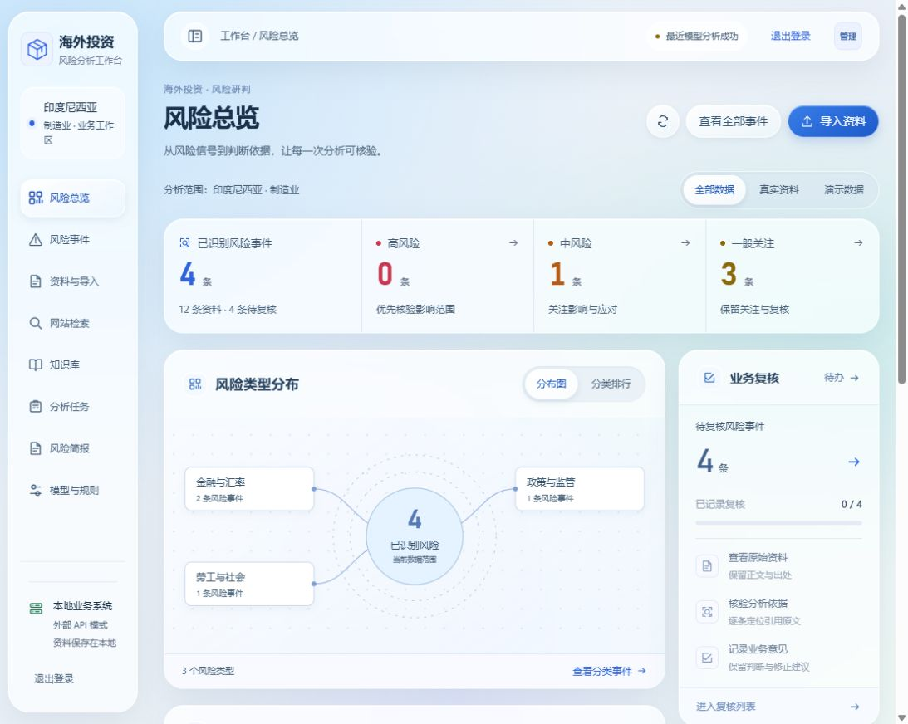
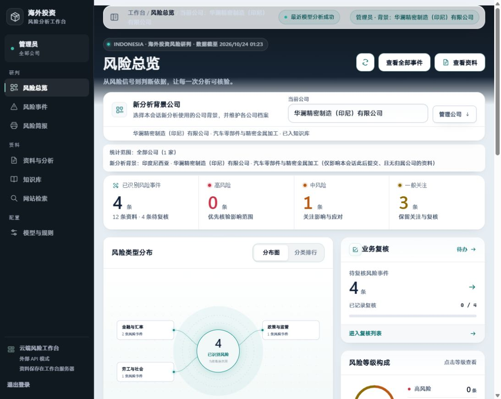
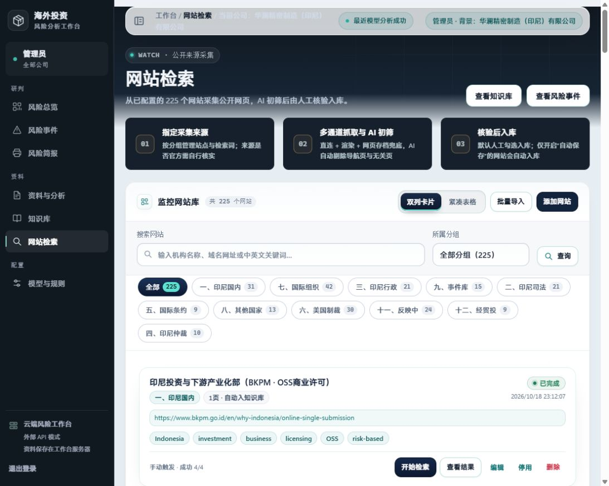
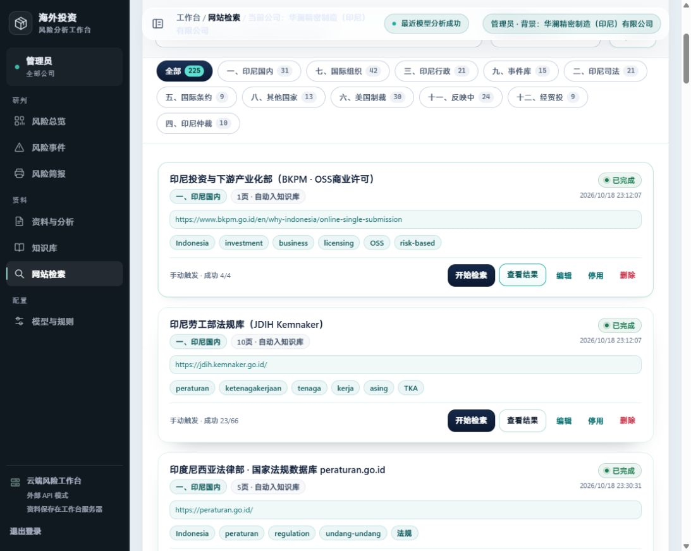
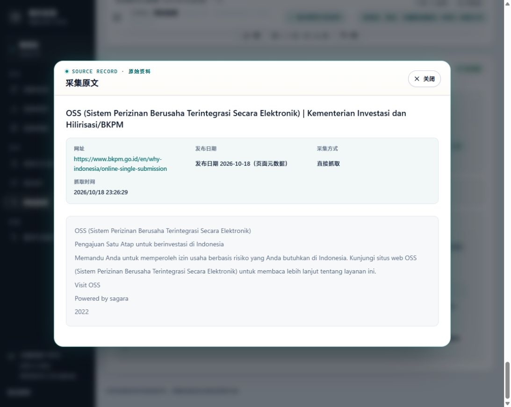
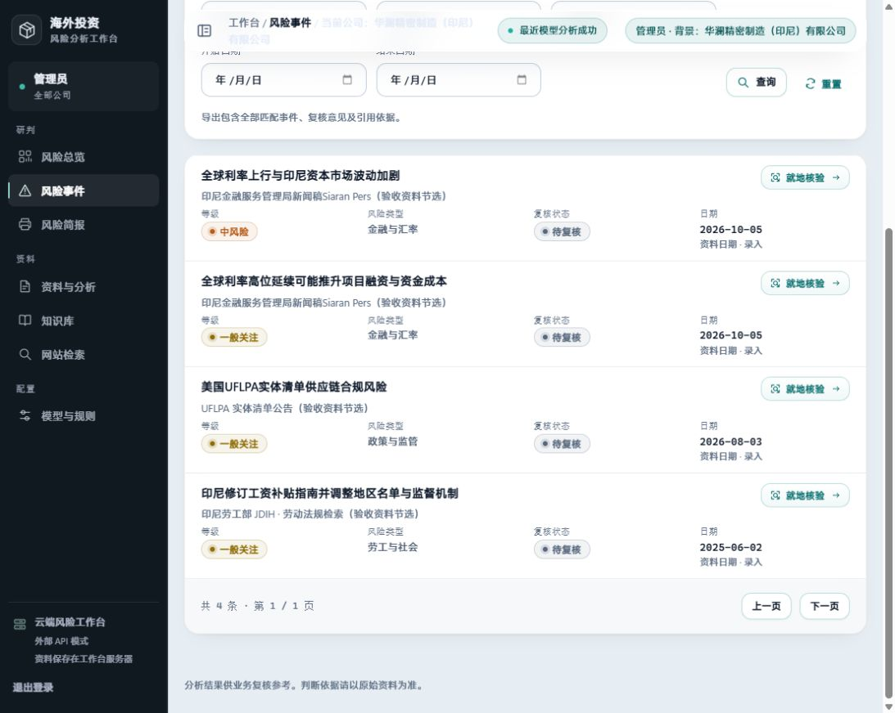
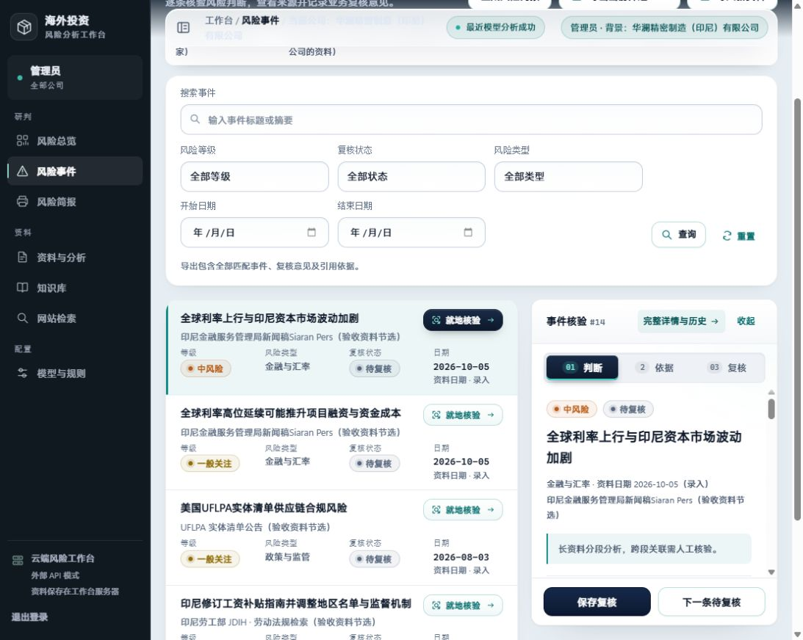
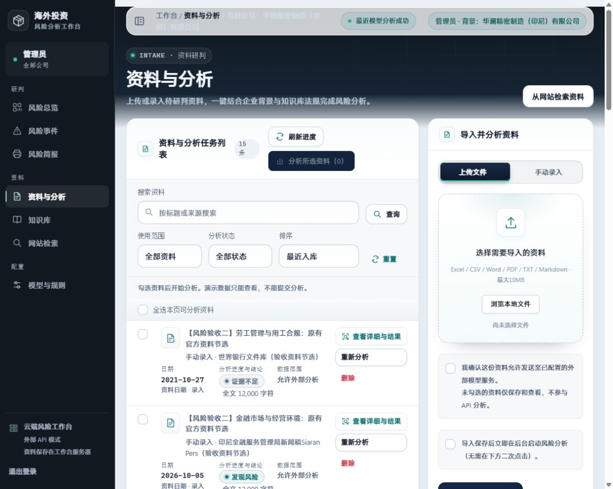
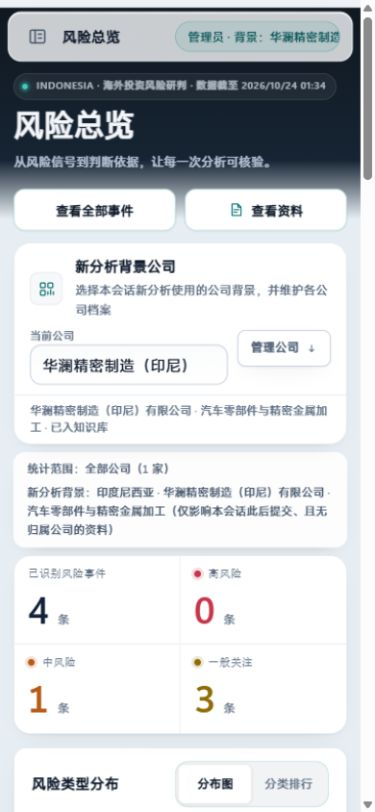

# 当前线上功能与页面审查 · 2026-10-24

审查对象：https://47.108.51.138/rag/ ，部署目录 20261023-premium-interactions。

方法：本次线上浏览器截图、页面结构和实际导航操作；补充服务器只读采集状态。主方法为 Product Design Audit，使用 Impeccable 的 Operate 原则辅助判断。这不是完整的 Impeccable 双人 critique，也未运行其页面注入检测。没有提交复核、发起采集或模型分析，没有修改线上配置。

整体判断：资料、检索、证据定位与业务复核已连通。更值得投入的是操作效率、数据时效和状态解释。现有深色侧栏、青绿强调与玻璃容器可以保留。

## 走查步骤

1. **打开及刷新总览：可用，存在版本滞留风险。** 原标签登录后仍是旧蓝白导航与旧字段；刷新后变为当前深色侧栏、公司背景和资料分析合并入口。长时间打开的页面需要发布版本提示，避免旧前端继续消费新接口。仅确认本标签的行为，尚未定位 HTTP 缓存或页面驻留机制。
2. **总览及公司背景：功能清楚，但占据主任务空间。** 侧栏、面包屑、身份标签、公司面板、统计范围和说明多次表达背景。公司选择影响新分析，不改变全部公司统计；两者视觉混在一起，容易被理解为公司筛选。建议把“统计范围”与“新分析背景”分成两个明确控件，稳定配置默认折叠。
3. **网站库与查看结果：站点资料齐全，结果定位不顺。** 225站分页，支持分组、搜索和显示切换；分组顺序为一、七、三、九等，名称还存在截短。点击首站“查看结果”后，下方任务已切换为 #131，但截图仍在卡片列表。建议结果抽屉或独立结果区，切换后明确定位并保留返回位置；分组按原始序号排序，提供完整名称。
4. **采集原文：可查看，状态与时效还需解释。** 网址、采集方式、抓取时间和日期来源已可见。#131同时显示0篇相关、1篇常驻，以及同一条目“已剔除”和“已在知识库”；不能据此断言错误入库，可能是历史记录。需标明“本次AI判定”“历史入库版本/时间”“本次新增入库”。旧网页存档、页面元数据日期应在进入知识库和风险分析时继续保留清晰来源标签。
5. **风险列表与就地核验：可用，阅读空间不足。** 引用原文定位、判断/依据/复核导航、下一条待复核和暂存说明齐全。在约1092px宽窗口中，筛选区占高较多，右栏正文只剩一小段，标题和来源几乎占满首屏。建议核验侧栏贴顶、按视口独立伸展；进入复核时折叠高级筛选；窄桌面使用更宽抽屉或专注阅读模式。未保存任何复核意见。
6. **资料与分析：基本完整，下一步动作可更明确。** 有状态、字数、外发授权、隔离标识、批量分析和导入入口。左列表与右导入栏并排使标题较长的资料难以扫描。建议宽屏保留分栏，窄桌面导入改抽屉；为“证据不足”提供缺失依据和补充入口；优先把待分析、失败、证据不足分成可直接处理的队列。
7. **手机总览：无横向溢出，主图仍被挤出首屏。** 390×844视口的页面宽375px；公司选择、公司概况和范围说明重复占位，分布图仅露出标题。建议公司背景收成一行，可展开编辑；统计后直接呈现可读分布图，再展示次要说明。

## 优先级与建议

| 优先级 | 改进 | 验收方式 |
|---|---|---|
| P1 | 修复“查看结果”定位与跨页面滚动位置 | 选站后直接看到对应结果；主导航进入页面时显示标题；返回列表恢复原位置 |
| P1 | 压缩公司背景和重复说明，分布图继续默认优先 | 手机更早看到完整分布图；“统计范围”和“新分析背景”不互相暗示 |
| P1 | 增加数据新鲜度和采集健康区 | 分开展示页面刷新、最近采集成功、最近分析成功时间；久未更新有明确提示 |
| P1 | 网站库增加工作状态与结果用途筛选 | 可以直接找未运行、失败、待人工判定、新入库未分析；显示失败原因和重试入口 |
| P1 | 放大核验正文的可用空间 | 当前桌面窗口能连续阅读摘要与引用，保存和下一条保持可见 |
| P2 | 拆清采集判定、历史入库及本次入库状态 | 0命中与历史1篇常驻同时出现时，有对应版本和来源解释 |
| P2 | 对证据不足、相似事件、待复核形成待办 | 证据不足有补充方向；同来源相似事件可关联；待办可按优先级连续处理 |
| P2 | 统一可读性和列表密度 | 顶栏面包屑在浅色背景清楚可读；长标题不挤压操作；来源正文可放大阅读 |
| P2 | 发布版本及设计文档同步 | 驻留旧版本有刷新提示；本地规范能说明当前线上版本 |

功能扩展可考虑为事件补充责任人、处理期限、处置记录和关闭状态；应先明确业务复核与风险处置的区别，再增加字段。当前并未验证角色权限和消息通知配置，不据页面未展示断言后端不存在。

## 采集状态补充

本次只读核对：225个启用网站，0个开启定时；检索136次，72完成、44失败、20取消；最后提交检索任务为2026-10-20 15:15:45（北京时间）。因此“监控网站库”和页面刷新时间不能表达正在持续监控。建议先提供站点分组、有限并发、预算和失败退避，再由业务选择少量重点站点定时运行；本次没有启用定时或自动风险分析。

## 可访问性与范围限制

截图中顶部公司面包屑有浅色字落在浅色背景的可读性问题，原文正文偏浅。未测量对比度数值，不能据此声称WCAG合规或不合规。未进行完整键盘/读屏测试、真实手机性能测试、200%缩放测试、模型输出质量和真实预警准确率验收。风险简报、知识库详情、完整详情页和角色权限未逐页完成走查。浏览器工具有明显通信等待，不将其当作产品加载性能数据。

## 本次截图

旧标签状态，仅作版本滞留对照：

步骤1–2：当前总览。

步骤3：网站库。

步骤3：点击查看结果后仍停在卡片附近。

步骤4：采集原文弹窗。

步骤5：列表及核验面板。

步骤6：资料与分析。

步骤7：手机首屏。

