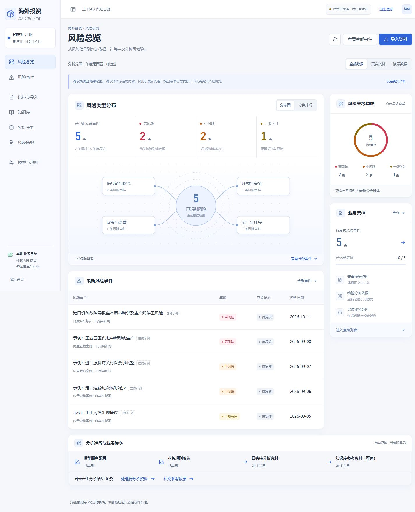
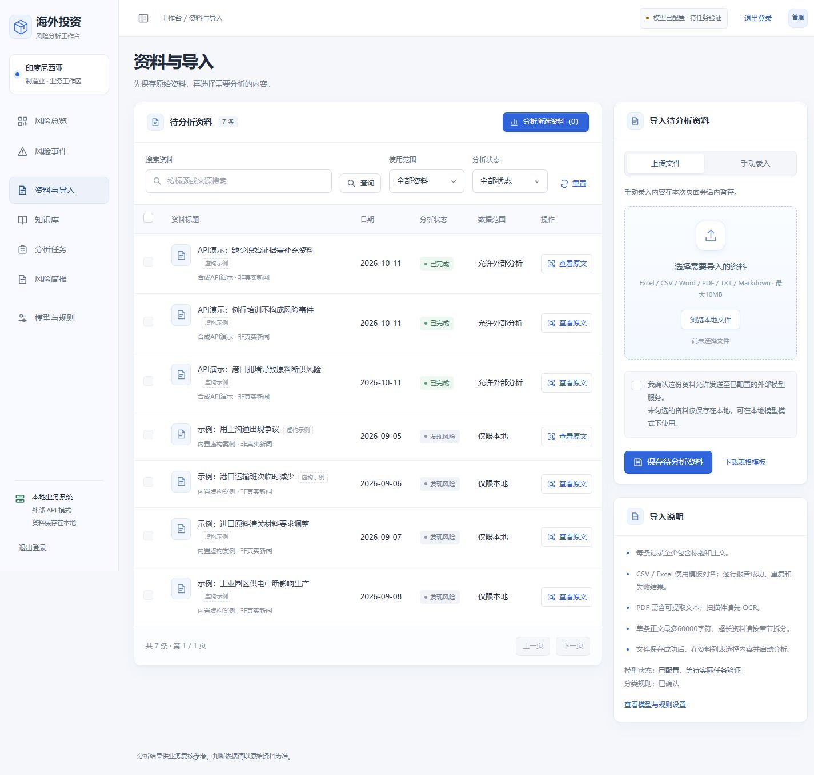
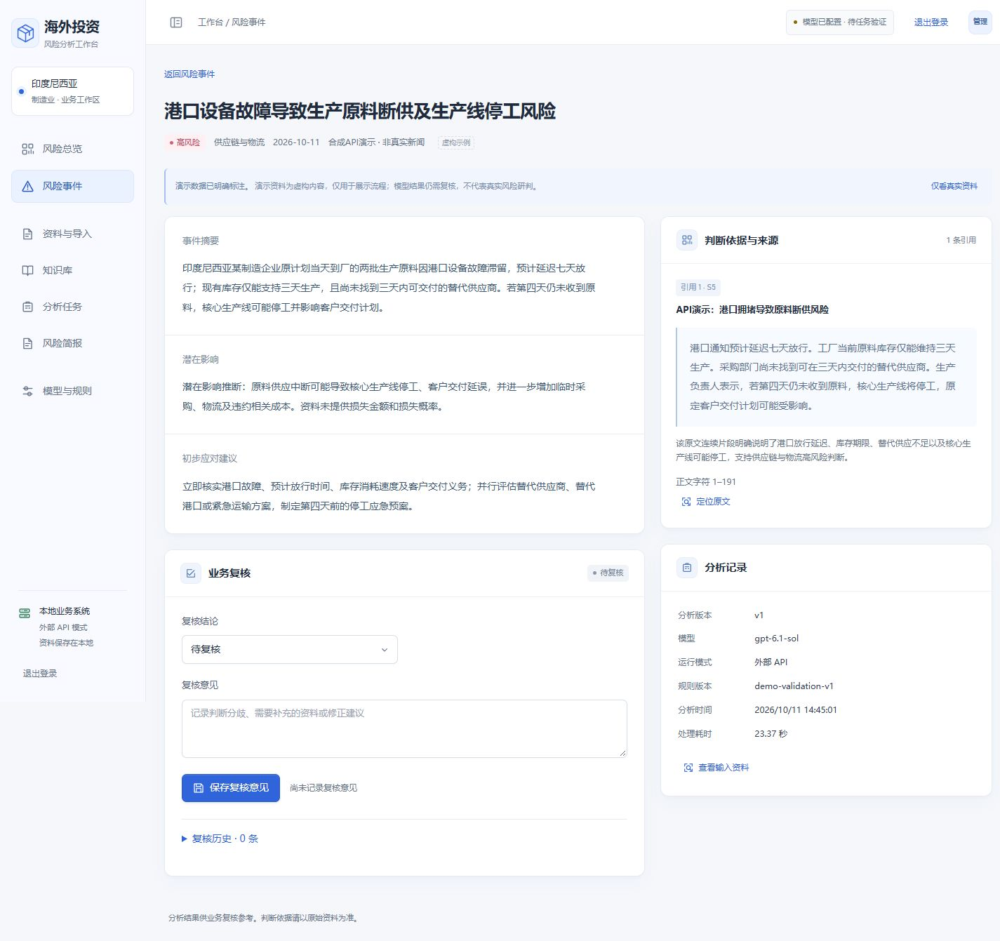
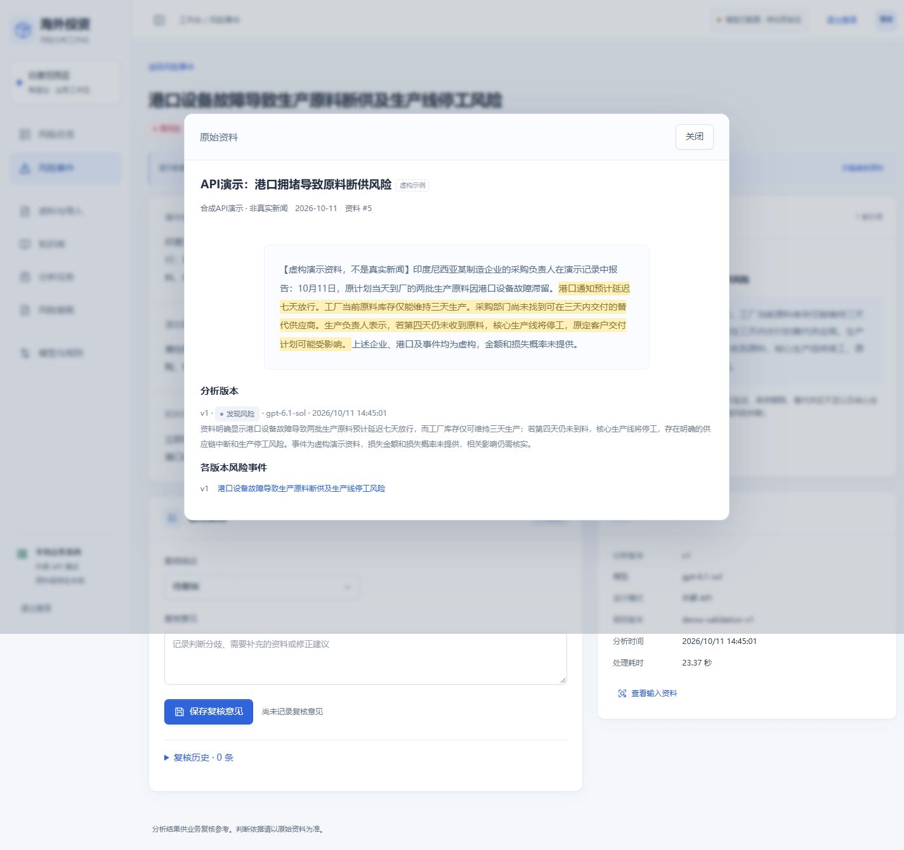
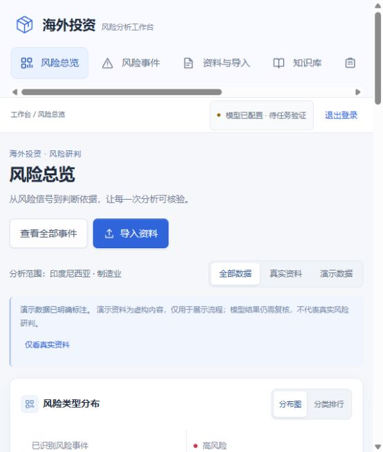
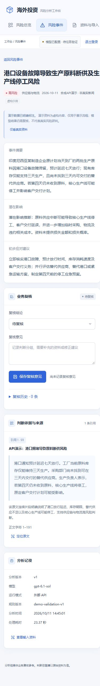

# 工作台 UI 审查 · 2026-10-11

范围：线上工作台的登录、风险总览、资料列表、风险详情和原文定位；桌面 1440×1000、小屏 390×844，以及默认窄面板。目标：让演示者快速解释结果，让业务人员完成“导入 → 分析 → 核验 → 复核”。

本报告记录首次审查。后续已实施首页排序、资料状态与禁用说明、模型状态、小屏菜单和证据优先的详情顺序，并新增网站检索入口；最终截图见 websearch-qa-20261011。

## 1. 登录 · 正常

使用新密码成功进入线上工作台。修复登录前后端至少 10 位的限制，允许既有 8 位管理员密码；首次初始化仍保留原有校验。28 项测试通过。

## 2. 风险总览 · 需要优化信息层级

优点：导航、卡片和风险等级样式一致，演示数据标识清楚，分类可以点击进入事件。

优先建议：缩小中间的风险关系图，把“待复核 5 条”、高风险事件和最近任务结果放到首屏。当前关系图与统计、右侧等级环图重复表达数量，最新事件被推到首屏下方。

顶部“模型已配置 · 待任务验证”与详情中已完成的 API 分析记录不一致。建议根据当前模型配置对应的最近成功任务显示“最近调用成功 · 时间”，明确这是历史成功记录，不代表实时在线探测。

## 3. 资料与导入 · 优先修正状态和操作说明

“待分析资料 7 条”包含已完成分析的示例，建议改为“资料列表 · 7 条”，增加“待分析 / 已完成 / 演示”数量摘要。已完成状态还应区分“发现风险 / 未发现风险 / 证据不足”，便于直接理解三个 API 演示结果。

演示资料的选择框禁用，但没有就近说明原因；“分析所选资料（0）”仍呈现为蓝色主要按钮。建议零选择时禁用按钮，并显示“演示资料仅供查看，导入新资料后可分析”。给每条已完成资料增加“查看分析结果”，减少通过原文弹窗寻找结果的步骤。

上传页也显示“手动录入内容暂存”的提示，应只在手动录入标签下显示。把导入提示从操作区域分离，保留紧邻上传按钮的格式、大小和失败恢复信息。

## 4. 风险详情与引用定位 · 核验能力良好，小屏顺序需调整

优点：结论、潜在影响、建议和引用分区清楚；定位原文可打开弹窗并高亮引用，分析模型和版本可追溯。

桌面可保留双栏。小屏当前顺序是摘要 → 复核表单 → 判断依据，用户在看到引用之前就遇到“保存复核意见”。建议调整为摘要 → 判断依据 → 业务复核；增加“查看依据 / 记录复核”的页内跳转，减少滚动。

## 5. 窄屏与移动端 · 导航发现性需要优化

默认窄面板的顶部导航出现横向滚动，390px 下后面的分析任务、简报和设置入口不直接可见。建议用可展开菜单收纳导航，明确显示当前页面。移动端将证据置于复核之前。

次优先建议：提高次级说明、资料来源和虚构示例标签的文字对比度，减少重复说明；保留风险等级文字，不能只依靠颜色。截图只能发现可读性风险，本次未做对比度数值、完整键盘和读屏合规审查。

## 建议实施顺序

1. 修正资料标题、结果状态、禁用说明和模型状态文案。
2. 调整首页，让待复核事项和最新事件进入首屏。
3. 优化小屏导航及“先证据、后复核”的阅读顺序。
4. 最后统一辅助字体、对比度、卡片留白与重复提示。

审查未提交复核意见、未重新调用模型、未修改业务数据。未覆盖所有设置、导入失败路径和辅助技术测试。
