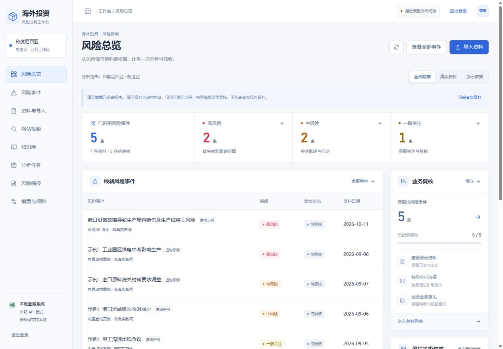
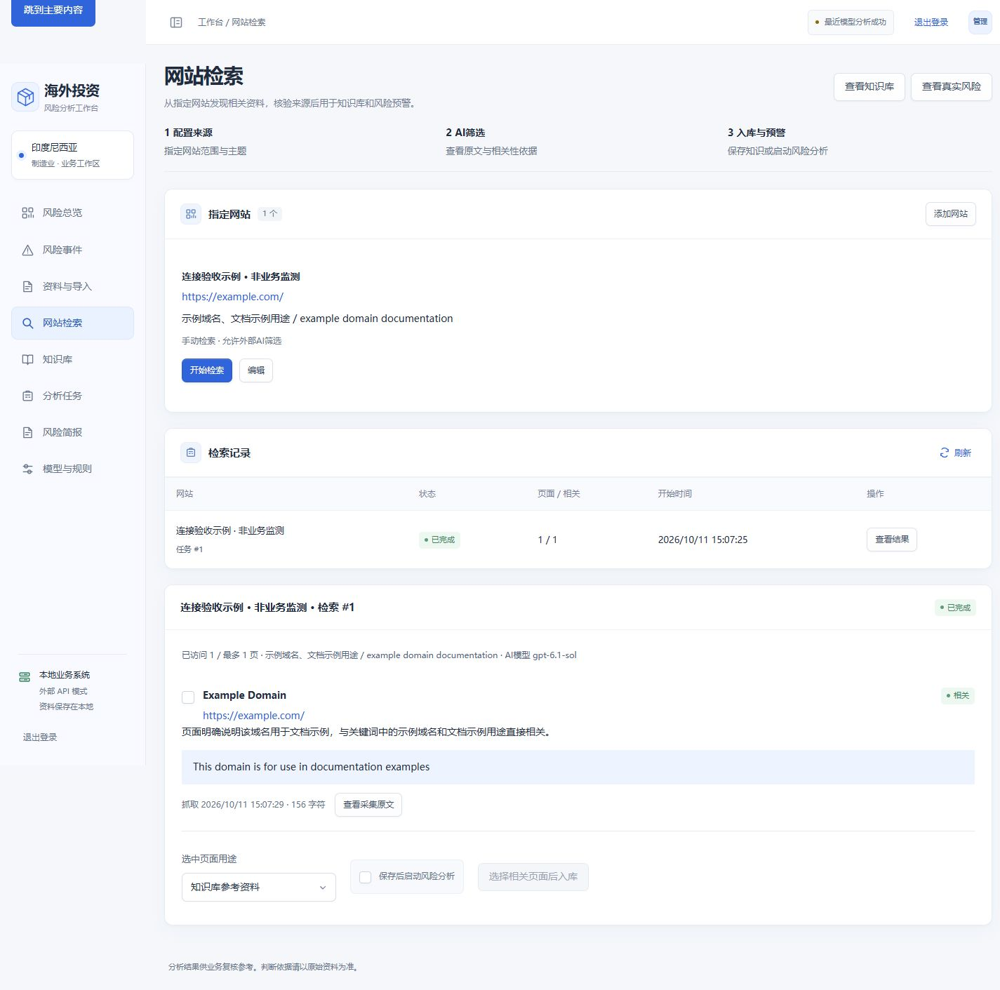
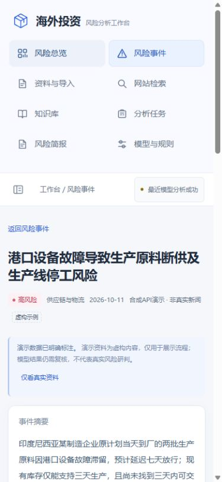
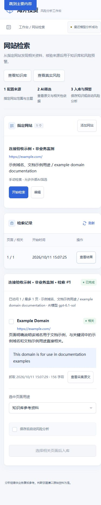

# 网站检索交付验收 · 2026-10-11

线上入口：https://47.108.51.138/rag/#websites

代码已部署到 `/opt/rag-workbench/releases/20261011-websearch`，继续使用原有 `rag-workbench` 隔离账号、虚拟环境、数据目录和 systemd 限额；其余站点与服务保持运行。升级前数据库备份：`/opt/rag-workbench/backups/pre-websearch-20261011/risk.db`。

## 功能验收

- 本地 Python 3.13 和服务器 Python 3.10：37 项回归测试通过。
- 真实浏览器表单添加公开示例域名，手动启动后台采集。任务 #1 成功保存1个页面，AI判定1个相关页面，连续原文引用可追溯。
- 真正调用顺顺云 `gpt-6.1-sol`，Responses 协议、推理低、响应存储关闭；没有把固定假结果当作AI结果。
- 在独立临时数据库内，将真实采集页面同时入知识库和风险资料，再调用真实模型。知识库和风险资料各1条，分析任务完成，结论 `non_risk`，未制造风险事件。临时数据库验证后清理。
- 正式数据库仍有7条演示资料、0条真实资料；公开域名验收记录未入正式知识库。定时网站数量为0，未开启持续调用。
- 浏览器已验证来源保存、开始检索、结果查看、选中后入库按钮启用、原文弹窗、小屏菜单；桌面1440px和小屏390px截图已检查。
- 服务健康接口正常，`rag-workbench`、`nginx`、`wuye-dashboard`、`danzishi-agent` 均运行；最后检查无服务错误日志。

## 界面证据

首页已将事件与复核置于分类图之前。

网站检索结果展示原文网址、抓取时间、AI相关性说明和引用。

小屏导航改为展开菜单；风险详情先显示引用依据，再填写复核意见。

支持范围和操作步骤见 [网站检索说明](WEBSITE-RETRIEVAL.md)。真实业务网站尚未指定，所以当前验收证明通用流程和真实模型调用可用；未来目标站点的栏目结构、robots许可和动态页面兼容性仍需针对性验证。站内风险待办已接入，邮件、短信等外部预警推送未配置。
