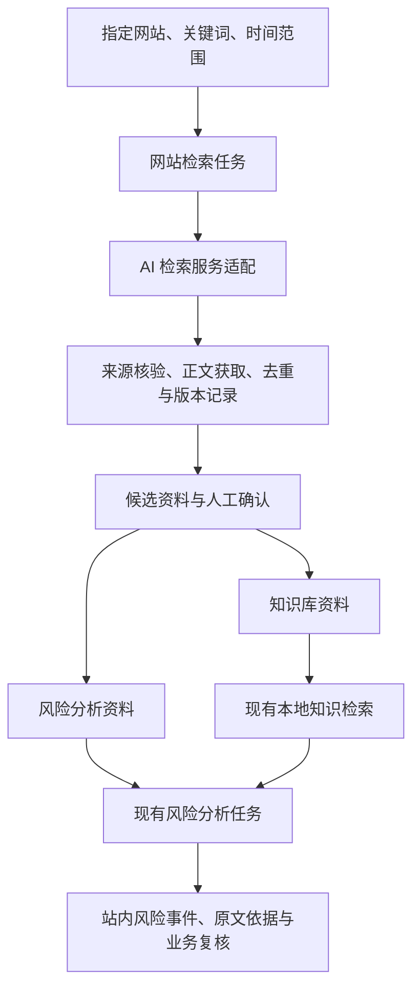

> 历史方案（2026-10-12归档）：本文件记录早期 Tavily 手动检索或容器部署方案。当前网站检索实现已替换为 `app/websearch.py`，支持指定网站采集、AI筛选、定时运行和核验入库，见 [当前使用说明](WEBSITE-RETRIEVAL.md)。已部署服务器使用独立 systemd 服务，见 [实际部署记录](DEPLOYMENT-SERVER.md)。保留容器部署文件作为可选方式。

# 指定网站检索、知识库建设与风险预警：需求方案草案

日期：2026-10-10

状态：需求范围参考；一期已实现手动检索与审核入库，首个适配为 Tavily。目标网站和真实接口联调待定；实际能力及边界以 [使用说明](WEBSITE-SEARCH.md) 为准。

## 1. 建议与对方确认的需求表述

在现有海外投资风险工作台中新增“网站检索”功能。用户配置指定网站、关注主题、关键词及时间范围，系统调用可替换的 AI 检索服务发现相关资料，获取可核验的来源内容并进行相关性筛选和去重。用户确认后，资料可进入知识库或风险分析流程，形成带原文依据、风险等级和复核状态的站内预警。

一期建议先支持手动检索、人工确认入库和手动提交风险分析。定时检索、自动分析及外部消息通知作为后续范围，待业务规则明确后评估。

## 2. 当前已知与待定条件

| 项目 | 当前状态 | 方案处理 |
| --- | --- | --- |
| 业务场景 | 当前项目面向印度尼西亚制造业投资风险 | 沿用当前场景；扩大国家或行业须另行确认 |
| 目标网站 | 暂未提供 | 支持配置来源清单；正式联调前提供代表性网站 |
| AI 检索服务 | 未指定 | 设计统一接口，以实际选定服务完成首个适配 |
| 实施阶段 | 当前仅整理需求和方案 | 不将本文描述视为已上线能力 |
| 检索频率和外部通知 | 未确认 | 一期按手动触发和站内展示规划 |
| 真实模型 | 当前环境未配置供应商 API | 检索与风险分析分别配置和验证，不混同两类接口 |

网站清单暂缺不妨碍方案设计，但无法据此承诺网站覆盖率、采集方式、准确工期或调用成本。

## 3. 用户操作流程

1. **设置来源与主题**：选择已配置的网站，填写关注主题、关键词、时间范围和结果数量上限。
2. **发起检索**：创建检索任务，查看等待、运行、完成、部分失败或失败状态。
3. **查看候选资料**：展示标题、来源网站、原始链接、发布时间、采集时间、相关性说明、正文获取状态及重复提示。
4. **确认用途**：按条或批量选择“加入知识库”“进入风险分析资料”或“忽略”。同一来源允许用于两个用途，但保留共同的来源标识。
5. **提交风险分析**：沿用风险规则确认、模型配置检查和资料外发授权流程。
6. **查看预警与复核**：在现有风险列表查看分类、等级、依据和建议，定位来源正文并记录复核意见。

检索无结果应明确展示“本次未检索到资料”；不能据此显示“没有风险”。检索服务失败、正文不可获取和风险分析失败分别展示，允许重试，不能伪装成成功。

## 4. 一期建议范围

### 4.1 网站来源与检索配置

- 支持来源名称、域名、启停状态及允许的栏目路径；是否包含子域名需明确配置。
- 支持检索主题、关键词、时间范围及单次结果上限。
- 一期使用配置好的来源清单，不实现全站遍历。
- 检索服务的域名过滤作为第一层约束，返回链接及跳转后的最终地址仍须核验来源范围。
- 时间范围筛选能力随检索服务而异；缺失或无法核实发布时间的资料单独标识，不推断其属于指定时间范围。

### 4.2 AI 检索与正文获取

- 检索服务负责发现链接，并可提供摘要、相关性说明或正文；风险分析服务负责按业务规则判断风险。
- 不预设当前 Chat Completions 接口具备联网搜索能力。服务须明确支持搜索工具、站点过滤或相应检索 API。
- 统一适配接口返回标题、URL、可用发布时间、检索摘要、正文及正文获取方式；记录服务名称和任务信息。
- 如果检索接口只返回摘要，再通过允许的页面获取方式提取正文；能够返回正文的服务也应标明其来源和获取边界。
- 原始页面或服务提供的正文快照、提取正文和 AI 摘要分别保存，支持核查，不能以生成摘要冒充原文。
- 只有摘要或正文不可用的结果可以保留为候选线索，一期不作为生成有原文依据的风险预警的输入。

### 4.3 资料筛选、去重与入库

- AI 可给出相关性建议；一期由用户确认入库和资料用途。
- 法规、政策、行业背景一般用于知识库；新闻、公告、突发事件一般用于风险分析。由用户决定具体用途。
- 根据规范化链接和正文摘要校验值识别重复；处理同一内容通过不同链接重复出现的情况。
- 同一页面正文变化时保留新版本和采集时间，不覆盖旧预警引用的内容。
- 保留标题、来源、原始链接、最终链接、发布时间、采集时间及检索任务关联。
- 正文长度及附件大小遵循现有应用限制；超限资料明确提示并保留线索，不静默截断影响引用。
- 已有知识库使用本地 BM25 检索；一期继续复用。语义向量检索不是本次新增功能的必要条件。

### 4.4 站内风险预警

- 一期“预警”定义为生成站内风险事件，并在现有总览、列表和详情中展示，不包含外部推送。
- 沿用已确认的分类及红、橙、黄等级规则，不因资料来自网站而自动认定其有风险。
- 每条风险必须引用所保存来源正文中的连续片段，支持来源定位和人工复核。
- 记录来源版本、分析版本和规则版本；同一来源版本重复提交不重复生成同一轮预警。
- 新版本再次分析可以生成新的分析结果；跨网站同一事件的合并另行制定规则，一期不承诺自动合并。
- 非风险或资料不足保留分析状态；资料不足提示补充证据，不生成无依据的预警。

## 5. 与现有项目的衔接

| 模块 | 当前能力 | 拟新增或调整 |
| --- | --- | --- |
| app/config.py、app/model.py | 可配置风险分析模型与协议校验 | 单独配置检索服务；不将检索服务绑定为现有分析模型 |
| app/ingest.py | 手动或文件资料入库、内容去重、分段 | 复用入库能力；新增网站来源元数据、来源版本和检索任务关联 |
| app/store.py | SQLite 资料、分析、任务、审计 | 新增来源配置、检索任务、检索结果和来源版本等持久化记录 |
| app/retrieval.py | 本地知识库检索 | 继续检索审核入库的网站资料 |
| app/jobs.py | 单进程风险分析队列 | 与检索任务区分状态；复用风险分析流程，补充重复预警控制 |
| app/main.py、web/ | 资料、任务、知识库和风险复核界面 | 新增网站检索、来源配置、候选资料筛选及任务详情入口 |

具体表结构与 API 在进入实施阶段后确定。保留现有单机、单进程部署方式；不在本次需求中默认引入向量数据库、独立消息队列或多服务部署。

## 6. 网站与服务兼容性边界

- 优先选择有公开 API、RSS、站点索引或可获取文本正文的网站，再评估需动态渲染的网页。
- 不承诺搜索引擎已收录每篇内容；“指定网站检索”并不等于全站完整采集或实时监控。
- 登录、付费、验证码、访问限制、扫描件 OCR 和复杂动态页面，待网站清单提供后单独评估。
- 网站数据须符合其授权和使用条件。来源清单、栏目和调用频率由项目双方确定。
- 网站页面作为待分析数据处理，避免其中指令改变系统分析规则；页面请求须限制目的地址、跳转、大小、超时和频率。
- 外部检索通常需要发送主题和关键词；外部分析需要发送被授权的正文及知识片段，保留现有资料外发授权机制。
- 配置检索供应商及目标网站所需的网络访问；密钥在安全配置处填写，页面与日志不展示密钥值。

## 7. 一期验收建议

验收前共同确认代表性网站、已知可获取的样本页面和业务主题，再确定数量、时延及业务质量指标。先验收以下行为：

| 场景 | 验收标准 |
| --- | --- |
| 站点范围 | 不符合配置域名、栏目或最终跳转范围的结果不进入可入库清单 |
| 搜索与采集 | 能展示实际返回的结果、正文获取状态和来源信息；无结果与服务失败可区分 |
| 时间信息 | 保留可核实发布时间；时间未知的资料明确标识，不伪造时间 |
| 证据保留 | 原始来源内容、正文和 AI 摘要分开；预警引用可在对应版本正文中定位 |
| 重复与更新 | 重复检索不重复入库；正文更新保留新版本和旧引用 |
| 资料分流 | 确认后的知识资料可检索，事件资料可提交现有风险分析 |
| 预警生成 | 风险规则、等级和引用校验生效；无风险、资料不足与分析失败分别展示 |
| 外发授权 | 未授权资料不能进入外部模型分析，包括被检索到的知识参考资料 |
| 任务与重试 | 重启、超时、限流及单条获取失败可追踪；重试不造成重复资料或预警 |
| 现有功能 | 原有资料导入、知识检索、分析、复核及备份恢复回归测试通过 |

业务识别效果需要另用甲方标注的风险、非风险和资料不足样本评估，约定召回率、误报率和分类分级一致性目标。工程功能通过不等于实际预警质量通过。

## 8. 分阶段推进

1. **需求与可行性确认**：收集代表性网站、主题和样本；评估检索服务的站点过滤、正文可用性、价格及数据处理方式。
2. **一期闭环**：来源配置、手动检索、候选资料、去重和版本、人工确认入库、手动风险分析及站内预警。
3. **定时与自动化**：增加检索计划、增量规则、失败重试和调用额度；确认哪些来源可自动入库及分析。
4. **外部通知与运营**：确定通知渠道、接收人、等级阈值、去重周期、重复提醒及处理状态，再实现推送和回执。

定时任务必须考虑服务重启和中断恢复；通知任务须与“风险识别完成”区分状态。第三、四阶段另行确认范围，不默认包含在一期中。

## 9. 需要对方后续补充的信息

| 信息 | 最低需要的内容 | 影响 |
| --- | --- | --- |
| 网站与访问条件 | 建议先给 2–3 个代表性网站、栏目或样本链接，说明是否需要登录 | 正文获取方式、覆盖范围和适配成本 |
| 检索主题 | 关键词、语言、关注国家和行业，相关与无关示例 | 相关性筛选及查询策略 |
| 时间要求 | 查询历史范围、允许的发现延迟及期望频率 | 手动还是定时，以及费用和资源 |
| 资料用途 | 哪些进入知识库，哪些触发风险分析；是否允许自动入库 | 审核及自动化流程 |
| 预警标准 | 分类分级规则、例子、是否需要通知及通知对象 | 风险阈值与验收标准 |
| 服务与预算 | 可用服务、接口额度、数据外发要求、预算范围 | 供应商选型及调用限制 |

月度运行费用应分别考虑检索调用、正文采集或浏览器渲染、风险分析模型及存储。网站和频率明确后再估算，当前不作固定报价或工期承诺。

## 10. 可直接发给对方的沟通文本

> 这个功能可以作为现有风险工作台的扩展。建议先实现：配置指定网站和关键词，调用 AI 检索服务获取相关资料，保留原文和来源链接，经确认后加入知识库或提交风险分析，生成可追溯的站内预警。为保证判断依据可靠，检索摘要与来源正文会分开保存，并支持重复资料识别和更新版本记录。第一阶段建议采用手动检索及人工确认，后续再按需要增加定时检索、自动分析和消息推送。请先提供几个代表性网站或栏目、关注主题和预警样例，我们据此验证资料获取能力，并确定接口选型、实施范围及费用。
